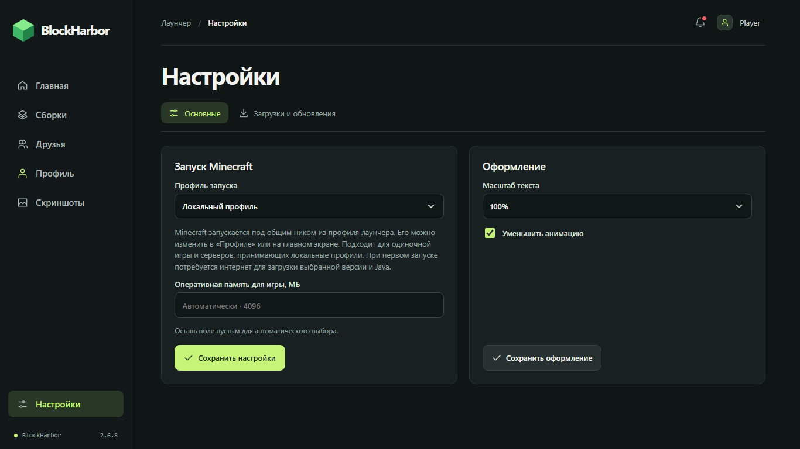
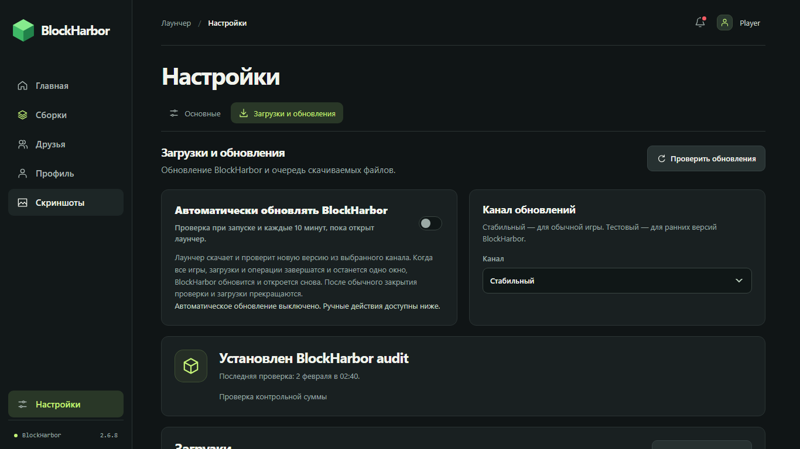

# UX: настройки и логотип BlockHarbor

Дата: 24 ноября 2026 года. Версия приложения: **2.6.8**.

Изменения относятся к разделам «Настройки → Основные», «Настройки → Загрузки и обновления» и существующему логотипу. Ветка: `audit/ux-settings-2026-11-24`.

Проверяемый исходник: [`9720ba5ab97e6bd4d552436e3ed4392fe504a44e`](https://github.com/dedt1mon/BlockHarbor/commit/9720ba5ab97e6bd4d552436e3ed4392fe504a44e). [Финальный прогон CI](https://github.com/dedt1mon/BlockHarbor/actions/runs/45448193348).

## Что исправлено

| Область | Причина | Результат |
| --- | --- | --- |
| Профиль запуска, масштаб текста, канал обновлений | Правило `label > .field { display: block }` заменяло внутреннюю flex-компоновку `base-select` | Выбранное значение центрируется по вертикали; сохранены место для стрелки и относительная высота строки |
| Поле памяти и соседние списки | Числовое поле и списки использовали разную внутреннюю компоновку текста | Списки согласованы с числовым полем; проверяются автоматическое и ручное значения памяти |
| Описания в настройках | Общий `max-width: 80ch` ограничивал текст внутри широкой панели | Описания используют внутреннюю ширину своей карточки |
| Основные настройки | Карточки шли последовательно в одной колонке | «Запуск Minecraft» и «Оформление» стоят рядом при достаточной ширине; кнопки сохранения выровнены снизу |
| Загрузки и обновления | Первые две карточки занимали отдельные строки; поле канала дополнительно ограничивалось по ширине | Автоматическое обновление и канал размещены рядом; поле канала занимает ширину карточки |
| Узкое окно | Две колонки могли бы слишком сузить содержимое | Сетка автоматически переходит в одну колонку; статус версии и очередь загрузок занимают полную ширину |
| Логотип | Несколько граней отдельно сглаживали общий внешний край | Сохранены форма и цвета куба, внешний силуэт рисуется один раз; PNG и девять размеров ICO пересобраны из того же исходника |

Основные изменения находятся в `ui/style.css`, `ui/app.js`, `ui/experience.js`, `ui/updates.css`, `ui/updates.js` и `ui/icon.*`. Генератор значков — `tools/render_windows_icon.py`. Для браузеров без `base-select` сохранено прежнее нативное поведение списка.

## Проверка

Финальный workflow и обе jobs завершились **success**. Все шаги выполнены успешно, включая штатные проверки Python/JavaScript/Go, сборку Windows-приложения и проверку установщика.

| Браузерная проверка | Linux | Windows |
| --- | ---: | ---: |
| Сочетания разрешения и DPR | 24/24 | 24/24 |
| Группы сценариев | 414 | 414 |
| Целевые сценарии настроек | 6/6 | 6/6 |
| Измерения текста полей | 36/36 | 36/36 |
| Ошибки положения или обрезания текста | 0 | 0 |
| Максимальное отклонение центра текста | 0,59375 CSS px | 0,59375 CSS px |
| Высота измеренных полей | 44 CSS px | 44 CSS px |

Целевые настройки проверены в широкой области 1920×1080 при DPR 1 и узкой CSS-области 640×360 при DPR 2. Для каждой области применены масштабы приложения 100%, 85% и 120%. Проверены автоматическая и ручная память, длинное значение профиля, полный Client ID, выбранный масштаб, канал обновлений, полная ширина описаний и доступность первого/последнего пункта открытых списков. Отдельная общая проверка элементов прошла при 1440×900, 900×700 и 520×760.

Доказательства: [сводка и происхождение артефактов](evidence/settings-ux/summary.json), [Linux report](evidence/settings-ux/linux/report.json), [Windows report](evidence/settings-ux/windows/report.json), [метрики Linux](evidence/settings-ux/linux/field-metrics.json), [метрики Windows](evidence/settings-ux/windows/field-metrics.json). Сводка содержит SHA-256 исходных CI-архивов и сохранённых файлов. Снимки скопированы из артефактов без изменений.

## Снимки интерфейса

Снимки получены из настоящих UI-файлов в Windows Chromium с тестовыми ответами API. Имена, версия `audit`, память и время проверки на снимках относятся к тестовым данным.

### Основные, 1366×768

### Загрузки и обновления, 1366×768

Дополнительно сохранены [список каналов в узком окне](evidence/settings-ux/windows/channel-picker-narrow.png) и [список масштаба текста](evidence/settings-ux/windows/scale-picker-narrow.png).

## Уточнения к тестам

Первый прогон выявил ошибку подготовки нового сценария: переход на URL с тем же путём и hash оставлял прежний документ, открытую модалку и предыдущие настройки масштаба. Теперь каждый целевой сценарий загружает новый документ и ожидает применения настроек через штатный API.

Второй прогон подтвердил целевые Settings-сценарии на обеих ОС, но выявил нестабильное ожидание стиля фокуса в общей тестовой странице. Вместо фиксированной задержки она теперь ждёт завершения фактических CSS-переходов через `getAnimations()` и `Animation.finished`. Standalone-проверка использует Playwright и конечное ожидание результата документа. Проверки размеров, границ, переполнения и различимости фокуса сохранены, включая отдельный размер 520×760.

Между первым и финальным проверяемыми коммитами файлы интерфейса, логотипа и runtime приложения не менялись: последующие правки относятся к подготовке и синхронизации тестов и документации.

## Границы результата

Браузерная матрица эмулирует размер CSS-области и DPR; она не подтверждает нативное переключение системного DPI Windows или работу на конкретном мониторе пользователя. Масштабы приложения 85/100/120 применяются штатным кодом, но поля настроек используют размер шрифта в `px`: проверка подтверждает отсутствие сдвигов при смене этой настройки, а не масштабирование каждого текста.

Версия остаётся 2.6.8. Изменения подготовлены в отдельной ветке; релиз и слияние с `main` не выполнялись.
